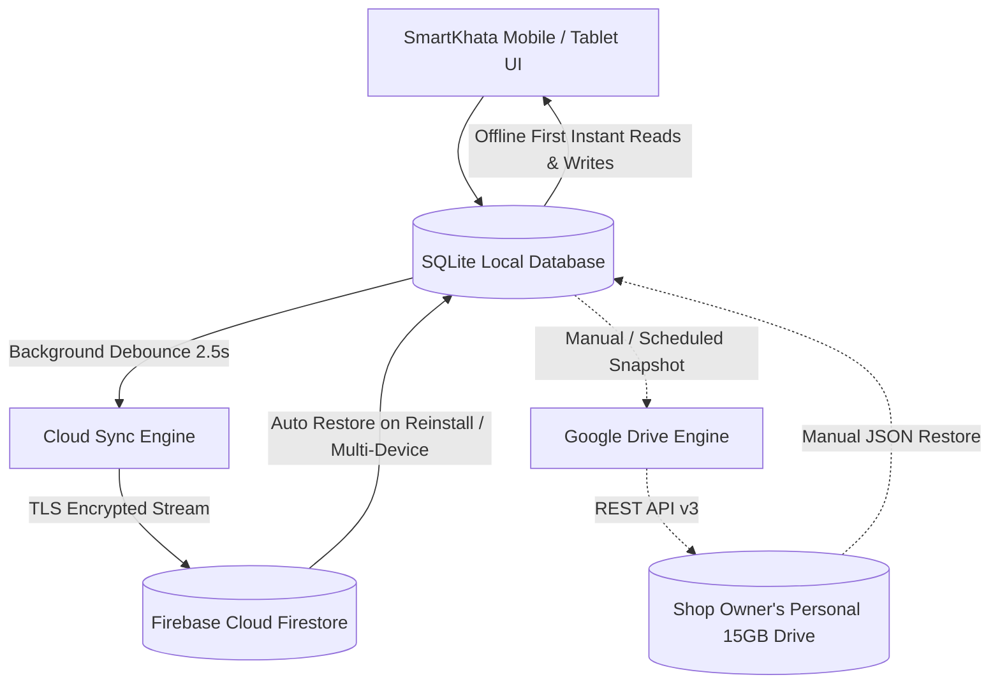

# SmartKhata (سمارٹ کھاتہ)

<p align="center">
  
</p>

<p align="center">
  <b>Modern Offline-First POS, Inventory & Digital Ledger System</b><br>
  <i>Tailored for Retailers, Wholesalers, Auto Parts, Garments, Pharmacies, Mandi Commission Agents, and Investors.</i>
</p>

<p align="center">
  
  
  
  
  
  
  
</p>

---

## 📌 Table of Contents
1. [Executive Summary & Problem Statement](#-executive-summary--problem-statement)
2. [Supported Business Verticals & Use-Cases](#-supported-business-verticals--use-cases)
3. [Core System Modules](#-core-system-modules)
4. [Step-by-Step User Guides & Operations](#-step-by-step-user-guides--operations)
   - [How to Add & Manage Products](#1-how-to-add--manage-products)
   - [How Stock Inward (Purchases) Works](#2-how-stock-inward-purchases-works)
   - [Investor, Partner & Multi-Device Sync](#3-investor-partner--multi-device-sync)
   - [POS Checkout & Split Payment Settlement](#4-pos-checkout--split-payment-settlement)
   - [Customer & Supplier Khata (Ledgers)](#5-customer--supplier-khata-ledgers)
5. [Dual-Engine Cloud Architecture](#-dual-engine-cloud-architecture)
6. [Google Cloud & Firebase OAuth Setup Guide (Fixing Project ID Labels)](#-google-cloud--firebase-oauth-setup-guide)
7. [System Architecture & File Organization](#-system-architecture--file-organization)
8. [Tech Stack & Libraries](#-tech-stack--libraries)
9. [Getting Started & Development Setup](#-getting-started--development-setup)
10. [Production Build & Deployment](#-production-build--deployment)
11. [Recent Quality Improvements & Bug Fixes](#-recent-quality-improvements--bug-fixes)
12. [UI/UX Design Standards](#-uiux-design-standards)

---

## 📌 Executive Summary & Problem Statement

### The Problem in Traditional Commerce
In Pakistan and developing South Asian retail markets, small and medium enterprises (MSMEs) run on complex physical networks:
- **Fragile Paper Ledgers (*Bahi Khata*):** Handwritten khata notebooks get physically damaged, lost, or forged, leading to disputed customer balances and severe bad debts (40% to 70% of transactions in Pakistani retail are conducted on *Udhaar* / credit).
- **Internet Instability:** Cloud-only POS solutions fail when load shedding or mobile network outages hit. A shopkeeper cannot stop their billing counter during peak customer rush.
- **Complex Units of Measurement (UOM):** Modern global POS apps only recognize generic "Pieces" or decimal "Kg". Pakistani grain markets (*Ghalla Mandi*), cloth markets, and hardware stores trade in specialized local units like `Mann (40kg)`, `Bori / Bag`, `Carton / Box`, `Roll / Than`, and `Meter`.
- **Manual Supplier Inward Bills:** Store owners purchase inventory on credit from distributors, but lose track of payable liabilities versus current shop stock valuations.
- **Investor & Partner Blindspots:** Absentee shop investors or multi-partner businesses struggle to audit real-time stock levels, purchase costs, and gross margins without manual evening tallying.

### How SmartKhata Solves It
**SmartKhata** is an offline-first, dual-synchronized digital ERP and POS engineered specifically for these realities:
1. **Zero-Latency Offline Autonomy:** Powered by local SQLite. POS billing, stock deductions, and ledger entries work with 100% functionality without any internet connection.
2. **Automated Dual Cloud Mirroring:**
   - **Cloud Firestore:** Automatically streams changes to the cloud within 2.5 seconds of local activity.
   - **Google Drive Backup:** Allows shop owners to create encrypted snapshots in their own free 15 GB Google Drive.
3. **Universal Unit System:** Native handling of non-standard Pakistani trade units (`Mann`, `Bori`, `Carton`, `Meter`, `Roll`, `Pair`, `Dozen`, `Kg`, `Pcs`).
4. **Supplier Inward & Cost Auto-Update:** Entering a purchase bill simultaneously adds stock, updates inventory cost prices, and records payable credit in the vendor's ledger.
5. **Investor & Multi-Device Visibility:** Authorized partners and investors can log in on their personal smartphones or tablets to inspect real-time sales, inventory valuation, and net cash positions.
6. **Instant WhatsApp Statements:** Send itemized PDF receipts and payment reminders directly to customer or supplier WhatsApp numbers with a single tap.

---

## 🏢 Supported Business Verticals & Use-Cases

SmartKhata adapts to diverse commercial sectors across Pakistan:

| # | Business Type | Key App Capabilities | Primary Units (UOM) |
|---|---|---|---|
| **1** | **General Stores, Kiryana & Supermarts** | High-speed barcode scanner billing, loose items weighing, customer udhaar limits, and thermal receipt printing. | `Pack`, `Kg`, `Gram`, `Carton / Box`, `Pcs` |
| **2** | **Auto Spare Parts & Hardware Stores** | Part numbers in barcode/SKU, mechanic monthly khata, supplier purchase inwards with bills, and loose parts tracking. | `Pcs`, `Pair`, `Set`, `Box`, `Meter` |
| **3** | **Mobile, Accessories & Electronics** | Custom barcode sticker generator, supplier purchase tracking, and gross/net profit margin analytics. | `Pcs`, `Pack`, `Box` |
| **4** | **Garments, Cloth & Footwear Boutiques** | Measurement by meter/yard or rolls, seasonal customer credit tracking, and WhatsApp ledger reminders. | `Meter`, `Roll / Than`, `Pair`, `Pcs` |
| **5** | **Medical Stores & Pharmacies** | Supplier distributor invoices, safety reorder stock warnings, and clean itemized receipts. | `Pack`, `Pcs`, `Box` |
| **6** | **Wholesalers & Distributors (تھوک فروش)** | Multi-Store management (Godown vs. Front Shop), approved credit limits, and full A4 PDF ledger statements. | `Carton / Box`, `Bori / Bag`, `Pack` |
| **7** | **Dana Mandi / Grain Markets (غلہ منڈی)** | Commission agent (Aarhati) ledgers, farmer crop amad (Inwards), trader bori/mann invoicing, and truck challans. | `Mann (40kg)`, `Bori / Bag`, `Kg` |
| **8** | **Fruit & Sabzi Mandi (سبزی و پھل منڈی)** | Fast crate/carton/bori entry, daily cash/credit settlements, and wholesale rate management. | `Carton / Box (پیٹی)`, `Bori / Bag`, `Kg`, `Dozen` |
| **9** | **Cosmetics, Perfumes & Gift Centers** | Rush-hour checkout, multi-tender split payments (Cash + Raast), and customer loyalty logs. | `Pcs`, `Pack`, `Set` |

---

## 🌟 Core System Modules

### 🛒 1. Point of Sale (POS) Billing Engine
- **Hardware & Camera Barcode Scanning:** Powered by `mobile_scanner` with continuous scanning, auto-flash/torch, and duplicate-prevention debounce.
- **Dynamic Units of Measurement (UOM):** Native support for `Mann (40kg)`, `Bori / Bag`, `Carton / Box`, `Kg`, `Gram`, `Meter`, `Roll / Than`, `Pair`, `Pcs`, `Pack`, `Dozen`, and `Liter`.
- **Flexible Settlement Options:**
  - 💵 **Cash:** Built-in change return calculator with rapid denomination helpers (`+10`, `+50`, `+100`, `+500`, `+1000`).
  - 📖 **Udhaar / Khata (Credit Ledger):** 1-tap customer ledger posting with credit limit verification and overdue warnings.
  - 🔀 **Split Tender:** Collect partial cash and post the remaining balance to the customer's ledger in a single transaction.
  - 📱 **Raast Instant QR:** Dynamic payment QR for instant bank-to-bank settlement without payment gateway fees.

### 📖 2. Digital Khata & Double-Entry Ledgers
- **Unified Directory:** Categorized into Customers (*Receivables / آپ نے لینے ہیں*) and Suppliers (*Payables / آپ نے دینے ہیں*).
- **Audit-Proof Journal:** Full chronological timeline showing transaction dates, invoice references, debit/credit entries, and running net balances.
- **Credit Limit & Risk Alerts:** Set maximum credit ceilings per customer with real-time visual progress indicators and breach alerts.
- **Instant WhatsApp Invoicing:** Send itemized digital receipts and payment reminders directly to customer WhatsApp with a single tap.

### 📦 3. Smart Inventory & Stock Inward
- **Real-Time Catalog:** Wholesale cost price, retail sale price, stock quantity, safety reorder thresholds, and profit margin analysis.
- **Supplier Purchase Inward (Stock Restocking):**
  - Searchable supplier picker and dynamic product picker.
  - Itemized inward entries (quantity, purchase rate, total amount).
  - Flexible payment settlement (Paid from Cash in Hand or Added to Supplier Payable Ledger).
  - Automatically updates inventory stock counts and average cost prices.
- **Safety Reorder Alerts:** Visual badges and system notifications when product stock falls below custom reorder thresholds.

### ☁️ 4. Dual-Engine Cloud Resilience & Auto-Sync
- **Engine 1: Cloud Firestore Real-Time Mirror:**
  - Every inventory change, stock inward, sale, or ledger entry automatically schedules a background sync (2.5s debounce).
  - Automatic zero-click cloud restore upon Google/Email login or fresh application setup.
- **Engine 2: Google Drive Personal Backup:**
  - Free, encrypted backup directly into the shop owner's personal 15 GB Google Drive.
  - Zero server subscription fees and complete data ownership.

### 🖨️ 5. Printing & Digital Exports
- **Bluetooth ESC/POS Support:** Compatible with standard 58mm and 80mm wireless thermal receipt printers.
- **A4 PDF Statement Builder:** Generate clean, print-ready financial statements, stock catalogs, and customer account summaries.
- **Zero Paper Mode:** Instant digital receipt delivery via WhatsApp and Email.

### 🔒 6. Enterprise Security & Multi-Store Management
- **Terminal App Lock:** Hardware-level biometric authentication (Fingerprint on Android, Face ID / Touch ID on iOS) and 4-digit PIN.
- **Multi-Branch Switching:** Manage multiple store locations, warehouses, or mandi godowns from a single account.

---

## 📖 Step-by-Step User Guides & Operations

### 1. How to Add & Manage Products

Adding products to SmartKhata can be done in two ways:

#### Option A: Direct Catalog Entry (Inventory Screen)
1. Open the **Inventory** tab from the bottom navigation bar.
2. Tap the floating **`+ Add Product`** button.
3. Fill in the product details:
   - **Product Name:** e.g., `Super Basmati Rice` or `Makki Grains`.
   - **Barcode / SKU:** Tap the camera icon to scan a manufacturer barcode, or tap the dice icon to auto-generate a unique barcode.
   - **Business Category:** Select your industry sector (e.g., *Grains & Mandi*, *Kiryana*, *Auto Parts*, *Garments*, *Hardware*).
   - **Unit of Measurement (UOM):** Choose from `Mann (40kg)`, `Bori / Bag`, `Carton / Box`, `Kg`, `Gram`, `Meter`, `Roll / Than`, `Pair`, `Pcs`, `Pack`, `Dozen`, or `Liter`.
   - **Wholesale Cost Price (PKR):** What you paid to acquire the product.
   - **Retail Sale Price (PKR):** The selling price charged at checkout.
   - **Opening Stock Quantity:** Current physical quantity on your shelves.
   - **Low Stock Warning Level:** The minimum quantity that triggers a restock badge (default: 5).
4. Tap **Save Product**. The item is instantly saved to local SQLite and queued for Cloud Firestore sync.

#### Option B: On-the-Fly Entry During Stock Inward
When receiving a vendor delivery containing brand new items:
1. In the **Stock Inward & Purchases** screen, tap **`+ Add Product to Bill`**.
2. Tap the **`+ Create New Product`** button inside the product picker.
3. Enter the product details and save. The new product is created and **immediately selected** in your current purchase bill.

---

### 2. How Stock Inward (Purchases) Works

Stock Inward handles restocking, vendor bills, and supplier payables:
1. Navigate to **Inventory** -> Tap **Stock Inward** (or click the Restock icon on the dashboard).
2. **Header Details:**
   - **Invoice / Bill #:** Auto-generated unique reference (e.g., `PUR-202611-1120`), or type the distributor's printed bill number.
   - **Inward Date:** Defaults to today's date (tap to select a past date if recording backlogged bills).
3. **Select Supplier:**
   - Choose the vendor from your directory, or tap **`+ Add New Supplier`** to register a new distributor.
4. **Add Items to the Bill:**
   - Tap the prominent **`+ Add Product to Bill`** card.
   - Select the product, enter the quantity received, and enter the purchase cost per unit.
   - Tap **Add to Bill**. Repeat for all items on the invoice.
5. **Payment Settlement:**
   - **Paid Full (Cash/Online):** If paid immediately, cash is deducted from drawer balance and supplier balance remains 0.
   - **Full Udhaar (Payable):** If purchased on credit, the full bill total is automatically credited to the supplier's payable ledger (*آپ نے دینے ہیں*).
   - **Partial Payment:** Enter the exact amount paid now; the remaining balance automatically posts to the supplier's credit ledger.
6. **Auto-Cost Price Updating:** Check **Update inventory cost prices to bill rates** to automatically adjust your catalog's cost price to the latest invoice rate.
7. Tap **Save Inward & Update Stock**. Physical quantities are updated across the inventory in real-time.

---

### 3. Investor, Partner & Multi-Device Sync

For businesses with silent investors, non-active partners, or owners monitoring multiple shops from home:
- **Instant Cloud Mirroring:** Every purchase inward, sales transaction, and customer payment syncs to Firebase Cloud Firestore within seconds.
- **How an Investor Views the Business:**
  1. The investor installs SmartKhata on their Android, iOS, or Web device.
  2. The investor logs in using the business owner's Google account or registered credentials.
  3. SmartKhata performs a zero-click **Cloud Auto-Restore**, pulling all products, current stock values, customer receivables, supplier payables, and profit/loss reports.
  4. Real-time updates push automatically, allowing investors to monitor daily cash flow and stock depletion live from anywhere in the world.

---

### 4. POS Checkout & Split Payment Settlement

1. Navigate to the **POS Billing** tab.
2. Add items to the cart via:
   - High-speed camera barcode scanner (top bar button).
   - Tap-to-add from the catalog product grid.
3. Review cart quantities, discounts, and custom weight adjustments.
4. Tap **Proceed to Checkout**:
   - **Cash Sale:** Enter cash received. Change return is calculated automatically.
   - **Udhaar / Credit Sale:** Select a registered customer. The invoice total posts to their ledger. If the customer's credit limit is exceeded, a visual warning alert is displayed.
   - **Split Payment:** Collect partial cash (e.g., Rs. 5,000 cash out of a Rs. 15,000 bill) and post the remaining Rs. 10,000 to customer Udhaar in a single click.
   - **Raast QR:** Present instant Raast bank transfer QR for cashless digital settlement.
5. Tap **Complete Sale**. Print thermal receipt (58mm/80mm) or send an itemized PDF directly via WhatsApp.

---

### 5. Customer & Supplier Khata (Ledgers)

- **Party Directory:** Switch between **Customers** (*Receivables / لینے ہیں*) and **Suppliers** (*Payables / دینے ہیں*).
- **Party Profile:** Displays current net balance, credit limit, phone number, and address.
- **Transaction Timeline:** Chronological list of all sales, payments, purchases, and return entries.
- **1-Tap WhatsApp Reminder:** Generate a formal Urdu/English payment request with full ledger statement attached as a PDF.

---

## ☁️ Dual-Engine Cloud Architecture

SmartKhata protects business records against device theft, accidental deletion, water damage, and hardware failure using a dual-redundant cloud strategy:



---

## ⚙️ Google Cloud & Firebase OAuth Setup Guide

### Why Did `project-711388054106` Appear on the Phone?
When signing in with Google or authorizing Google Drive backups, Google's Android consent dialog displays the project name registered on the **Google Cloud Console > OAuth Consent Screen**. If the consent screen has not been configured with an App Name, Google defaults to displaying the raw project number (e.g., `project-711388054106`).

### Fixing Google Cloud Permissions & Branding (Step-by-Step)

#### Step 1: Resolve the "You need additional access" Permission Error
If opening Google Cloud Console shows:
> *"You need additional access to the project: 711388054106... Missing or blocked permissions"*

This occurs because your browser is logged into a secondary Google account rather than the primary Firebase Project Owner.

**To resolve:**
- **Option A (Account Switch):** In the top-right corner of Google Cloud Console, click your profile avatar and switch to the Google account that created the Firebase project (e.g., `ghulam2229mustafa@gmail.com`).
- **Option B (Grant Access via Firebase):**
  1. Open [Firebase Console](https://console.firebase.google.com) -> Select **SmartKhata**.
  2. Click the gear icon ⚙️ -> **Project settings**.
  3. Click the **Users and permissions** tab.
  4. Click **Add member**, enter your secondary email (e.g., `mustafafahhad29@gmail.com`), assign the role **Owner** or **Editor**, and save.
  5. Refresh Google Cloud Console. Access will be granted immediately.

#### Step 2: Configure the OAuth Consent Screen
1. Navigate to: [Google Cloud Console > APIs & Services > OAuth consent screen](https://console.cloud.google.com/apis/credentials/consent).
2. Select User Type: **External** -> Click **Create** (or **Edit App**).
3. Under **App information**:
   - **App name:** `SmartKhata`
   - **User support email:** Select your email address.
   - **App logo (optional):** Upload `assets/icons/app_logo.png`.
4. Under **Developer contact information**:
   - **Email addresses:** Enter your email address.
5. Click **Save and Continue** through the Scopes and Test Users screens.
6. Under **Publishing status**, click **Publish App** (or leave in Testing mode and add your email to Test Users).
7. **Result:** All Google sign-in and Google Drive consent dialogs on Android and iOS will now display **SmartKhata** with your official branding instead of the raw project number.

#### Step 3: Enable the Google Drive API (For Drive Backups)
1. Visit: [Google Cloud API Library > Google Drive API](https://console.cloud.google.com/apis/library/drive.googleapis.com).
2. Ensure project `SmartKhata` (`smartkhata-19806`) is selected in the top bar.
3. Click **Enable**.

---

## 🏛️ System Architecture & File Organization

SmartKhata implements a clean, reactive MVVM (Model-View-ViewModel / Service-State-View) architecture:

```
lib/
├── main.dart                          # App bootstrap, Firebase & database init
├── firebase_options.dart              # Multi-platform Firebase credentials
│
├── core/                              # App-wide constants, strings, theme & navigation
│   ├── app_colors.dart                # 100% Light theme palette (slate blue, forest green, alerts)
│   ├── app_strings.dart               # Unified string constants (English & Urdu context)
│   ├── app_theme.dart                 # Material 3 light theme definition & component styles
│   ├── app_routes.dart                # Named routing table
│   └── responsive_utils.dart          # Breakpoint calculations and device scaling
│
├── models/                            # Domain Data Models (Immutable)
│   ├── product_model.dart             # Inventory items, barcode, UOM units, pricing & stock
│   ├── party_model.dart               # Customers & Suppliers with balances & limits
│   ├── order_model.dart               # Invoices, items, payment mode, split amounts
│   ├── purchase_model.dart            # Stock inward purchases, supplier reference, bill no
│   ├── shop_model.dart                # Store profile, branch settings, receipt headers
│   └── notification_model.dart        # System alerts & operational notifications
│
├── services/                          # Core System & Hardware Services
│   ├── local_database_service.dart    # SQLite DB wrapper, atomic file writes & disk sync
│   ├── cloud_sync_service.dart        # Real-time Firestore auto-sync & auto-restore
│   ├── google_drive_service.dart      # Google Drive REST API v3 backup engine
│   ├── printing_and_sharing_service.dart # ESC/POS printer adapter, PDF builder & WhatsApp
│   ├── security_service.dart          # Local authentication (Biometrics & PIN hash)
│   ├── notification_service.dart      # In-app and system push notifications
│   └── auth_service.dart              # Firebase Auth & Google Identity Provider
│
├── state/                             # Reactive State Management (Provider)
│   ├── cart_state.dart                # Active POS cart, line items, discounts & weight
│   ├── inventory_state.dart           # Catalog cache, barcode index, stock deduction
│   ├── khata_state.dart               # Parties directory, balance tracking, ledgers
│   └── shop_state.dart                # Active store session & branch switcher
│
└── views/                             # User Interface (100% Light Theme)
    ├── auth/                          # Login, PIN setup & auto-restore onboarding
    ├── dashboard/                     # Executive dashboard, revenue cards & quick actions
    ├── inventory/                     # Catalog, Add/Edit product (UOM units), Purchase Inward
    ├── khata/                         # Party directory, Ledger details, Statement sheet
    ├── pos/                           # Barcode scanner, Cart, Checkout settlement
    ├── reports/                       # Sales revenue, Daily closing & P&L analytics
    ├── settings/                      # Multi-store, Cloud Firestore, Google Drive, Printers
    ├── notifications/                 # Real-time notification center
    └── shared_widgets/                # Custom AppBars, BottomNav, Drawer, Metric cards
```

---

## 💻 Tech Stack & Libraries

| Category | Technology | Purpose |
| :--- | :--- | :--- |
| **Framework** | **Flutter 3.x / Dart 3.x** | Cross-platform native mobile and web compilation |
| **Database** | **SQLite (`sqflite`)** | Offline-first, ACID-compliant local database engine |
| **Cloud Database** | **Cloud Firestore** | Real-time automated background synchronization |
| **Cloud Storage** | **`googleapis` (Drive v3)** | Google Drive personal 15 GB cloud backup |
| **Cloud Auth** | **`firebase_auth` / `google_sign_in`** | Secure user identification and cloud pairing |
| **State Management** | **`provider`** | Reactive, lightweight state management with minimal rebuilds |
| **Hardware Scanner** | **`mobile_scanner`** | High-speed camera barcode and QR detection (Android / iOS) |
| **Thermal Printing** | **`printing` / `pdf`** | Native ESC/POS thermal printing & PDF generation |
| **Biometrics** | **`local_auth` / `crypto`** | Fingerprint, Face ID, and SHA-256 PIN security |
| **External Sharing** | **`url_launcher` / `share_plus`** | Direct WhatsApp bill sending and OS sharing |
| **Localization** | **`intl`** | Number, currency (PKR), and datetime formatting |

---

## 🚀 Getting Started & Development Setup

### Prerequisites
1. **Flutter SDK:** Version `3.22.0` or higher ([Install Flutter](https://docs.flutter.dev/get-started/install)).
2. **Android Studio / VS Code** with Flutter and Dart extensions.
3. **Java Development Kit (JDK):** Version 17+.
4. **Git** installed on your system.

### 1. Clone the Repository
```bash
git clone https://github.com/FahadMustafa001/KhataSmart.git
cd KhataSmart
```

### 2. Install Dependencies
```bash
flutter pub get
```

### 3. Verify Code Health
```bash
flutter analyze
```

### 4. Run the Application
```bash
# Running on Android (Physical Device or Emulator)
flutter run

# Running on iOS (Mac & Simulator)
cd ios && pod install && cd ..
flutter run -d ios

# Running on Web (Google Chrome)
flutter run -d chrome --web-port=5000
```

---

## 📦 Production Build & Deployment

### Generate Optimized Android APK (Direct Sideloading)
```bash
flutter build apk --release
```
The resulting universal APK will be located in:
`build/app/outputs/flutter-apk/app-release.apk`

For smaller, architecture-specific APKs:
```bash
flutter build apk --release --split-per-abi
```

### Generate Android App Bundle (Google Play Store)
```bash
flutter build appbundle --release
```
The release bundle will be located in:
`build/app/outputs/bundle/release/app-release.aab`

---

## 🛠️ Recent Quality Improvements & Bug Fixes

- **Catalog Item 12px Overflow Resolved:** Resolved a horizontal layout overflow in [inventory_list_screen.dart](file:///c:/Users/fahad/StudioProjects/KhataSmart/lib/views/inventory/inventory_list_screen.dart) when large item prices caused badge rows to exceed device width. Replaced rigid `Row` + `Spacer` layouts with flexible `Expanded` + `Wrap` containers.
- **Stock Inward Screen Blank Screen Eliminated:** Migrated [purchase_inward_screen.dart](file:///c:/Users/fahad/StudioProjects/KhataSmart/lib/views/inventory/purchase_inward_screen.dart) to robust `CustomAppBar` architecture and modal sheets, preventing layout crashes when opening the inward restock portal.
- **Interactive Inward Empty State:** Replaced static "No products added yet" containers with an interactive `InkWell` containing a prominent **`+ Add Product to Bill`** button.
- **On-the-Fly Product Auto-Selection:** Products created on-the-fly from the purchase bill sheet now automatically return via `Navigator.pop(context, newProd)` and are immediately selected in the active inward invoice.
- **Universal Units of Measurement (UOM):** Added native support for agricultural and wholesale units (`Mann`, `Bori`, `Carton`, `Roll`, `Meter`, `Pair`, `Pcs`, `Pack`, `Dozen`, `Liter`).
- **Branding Uniformity:** Harmonized brand naming across Android manifests, iOS plists, web titles, and app-lock screens to **SmartKhata**.

---

## 🎨 UI/UX Design Standards

- **100% Light Theme Guarantee:** High-contrast slate blues (`#0F172A`), clean whites (`#FFFFFF`), forest greens (`#15803D`), and crimson alerts (`#DC2626`) engineered for clear visibility under supermarket and outdoor mandi lighting.
- **Zero Screen Overflows:** Scalable `FittedBox`, `Expanded`, and responsive scroll view architectures tested across standard and compact mobile screens.
- **Enterprise Touch Ergonomics:** Minimum 48px touch targets tailored for fast thumb operation on mobile and tablet counters.
- **Clean English UI:** Professional, unified English interface throughout the application with bilingual context support for Pakistani markets.

---

## 📄 License & Ownership

Developed with pride by the **SmartKhata Core Team**.  
All rights reserved. Dedicated to Pakistani retail, wholesale, and mandi commerce empowerment.
